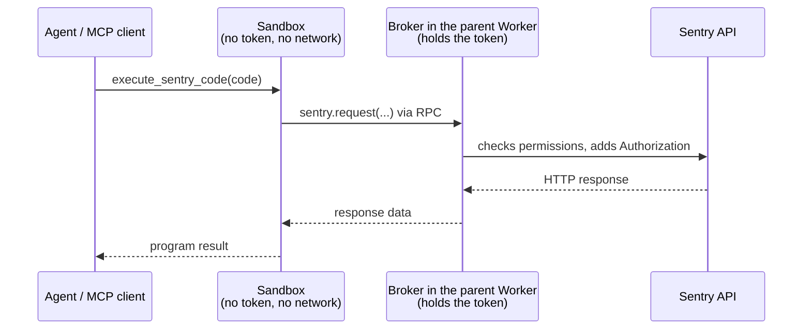

# HTTP Code Mode

HTTP Code Mode lets an external MCP agent discover published API operations,
write JavaScript, and run authenticated HTTP requests without a dedicated tool
for each operation. It is hosted-only. This version uses HTTP requests; an SDK
interface is deferred.

## Tools

- `search_sentry_api({code})` runs an async arrow function against the shipped
  OpenAPI document, available as `spec`. Network access is disabled.
- `execute_sentry_code({code})` runs an async arrow function with
  `sentry.request({method?, path, query?, body?})`, defaulting to GET. Requests
  return `{status, headers, body}`; non-2xx responses throw with HTTP details.
  Query arrays become repeated parameters; `headers.link` supports pagination.

The client's model discovers the API, writes the code, corrects failures and
writes the answer. The server runs the code and never calls a model. Programs
can paginate, combine responses and return selected fields without sending every
intermediate response to the model. Both are ordinary MCP tools (`tools/list`,
`tools/call`, `structuredContent`, `isError`), not a protocol capability.

## Execution

This follows Cloudflare's [server-side search/execute pattern](https://blog.cloudflare.com/code-mode-mcp/).
Each call loads a fresh Dynamic Worker through the `LOADER` binding with
`globalOutbound: null`, so raw `fetch()` and other network access fail. The
sandbox receives an `ApiBroker` RPC capability; generated code is a separate
module and cannot reach it or the token.



`registerCodeModeTools()` (`packages/mcp-cloudflare/src/code-mode/tools.ts`)
adds both tools to the server that `mcp-handler.ts` builds for each
authenticated request, capturing that request's `ServerContext`. The parent
Worker owns one `ExecutionGate` per call, with a 30-second deadline covering
startup, execution and reading the result:

- Programs must await every `sentry.request()`. Returning with calls pending, or
  leaving a rejection unhandled, fails the execution. Late catches and
  `Promise.allSettled` are fine.
- Closing the gate aborts upstream HTTP and refuses new calls, checked again
  after authorization, so a slow lookup cannot start a write after the program
  ended. It does not stop JavaScript still running inside the isolate.
- A write Sentry already accepted cannot be rolled back. There are no retries
  or transactions; failures tell the agent to inspect state before retrying
  writes.

`LOADER.load()` creates a fresh Worker per execution, without ID caching, which
keeps executions isolated and affects
[Dynamic Workers costs](https://developers.cloudflare.com/dynamic-workers/pricing/).
Reusing Workers would have to keep credentials and authorization per request.

## Permissions

Two skills control Code Mode on a connection:

- **API Read** permits reads.
- **API Write** permits reads and writes. It starts unchecked on the consent
  screen.

Code Mode never widens the token: the OAuth flow requests the same upstream
scopes, and Sentry still checks the token's scopes and the user's role and
resource access on every request. Code Mode reads neither `grantedScopes` nor
`upstreamScopes`. Permissions add up: API Write can change issues with **Triage
Issues** unchecked, or projects and teams with **Manage Projects & Teams**
unchecked. The consent screen says so and shows the organization scope. Existing
OAuth grants do not gain API skills, and stdio rejects them. Direct
`Sentry-Bearer` connections default to all active skills, API Write included,
because the client already holds the token; `skills` and `disable-skills`
narrow them.

Before each `sentry.request()`, the broker (`broker.ts`) checks:

1. The URL keeps the configured origin and `/api/0` prefix, with no encoded
   separators.
2. Without API Write, only reads (GET and HEAD) reach Sentry.

Then its `ApiAuthorization` (`authorization.ts`, `access.ts`) checks:

3. The path and method are a published operation. HEAD may use a published
   GET. Traversal segments, unknown paths and ambiguous paths fail.
4. On `/mcp/{org}`, the organization path parameter must be that organization.
   Other organizations, numeric aliases and global object-ID routes fail;
   query parameters cannot stand in for a scoped path.

Allowed requests go through `SentryApiService`, like every other tool: the
organization's regional host, MCP client attribution and the bearer header. Only
`accept` and `content-type` cross from the sandbox.
Redirects are not followed. A 401 invokes the unauthorized callback once.

Project-constrained connections (`/mcp/{org}/{project}`) do not get Code Mode.
A project URL does not prove isolation: release files can be shared across
projects, and release deploys can affect every project when `projects` is
omitted (`src/sentry/releases/endpoints/project_release_file_details.py` and
`release_deploys.py` in Sentry).

## API Schema

Code Mode ships its API data with the deploy; nothing fetches it at runtime.
`src/code-mode/generated/` holds, for the `@sentry/api` release in the pnpm
catalog (the release the CLI's `sentry api` and `sentry schema` use):

- `openapi.json.txt`: the published `openapi-derefed.json`, minified and
  ASCII-escaped, as a Workers Text module. Each search sandbox parses it.
- `operations.json`: method and path of each operation, for authorization.
- `source.json`: the release.

To move to a new release, bump `@sentry/api` in the catalog, install, and
regenerate in the same pull request. `openapi.test.ts` fails when either file
differs from the installed release. Never edit the generated files by hand.

```bash
pnpm --filter @sentry/mcp-cloudflare generate:openapi
```

The tool descriptions in `packages/mcp-core/src/code-mode.ts` guide the agent:
search paths, operation IDs, summaries, descriptions and tags with the user's
terms; read path-level and operation-level parameters; and for writes, read the
current resource, send required fields and requested changes, preserve IDs in
nested collections, and verify the result. These instructions cannot enforce
endpoint-specific semantics.

## Limits and Failures

Each execution has a 20-call budget, a 30-second deadline, a 50,000-byte result
limit and a 2,000,000-byte limit per upstream response. The hosted MCP's shared
input limits (`@sentry/toolkit-core/mcp-limits`) apply before the tool runs.
Dynamic Worker CPU and subrequest limits are set in the `load()` call; local
workerd does not enforce them, and hosted enforcement is not yet verified.

HTTP errors keep the status, message and allowed headers such as
`WWW-Authenticate` and `Retry-After`. Upstream 5xx responses create a Sentry
issue through `logIssue`, even when the program catches them; the response
carries the event ID as `x-sentry-event-id`. Failures outside the program, such
as the Worker Loader failing, also create an issue and end the tool error with
the event ID. Program errors, 4xx responses and the deadline do not. Every
failure keeps the tools' `{error, stats}` output shape.

## Telemetry

Each `tools/call` span records the execution:

- `gen_ai.tool.call.arguments.code`: the generated program
- `app.code_mode.outcome`: `ok`, `error`, `timeout` or `internal_error`
- `app.code_mode.spec_version`: the `@sentry/api` release shipped
- `app.code_mode.api_calls`, `app.code_mode.writes`: calls the broker saw and
  writes it sent (execute only)
- `app.code_mode.operations`: JSON list of `METHOD template status`, with
  `denied` when this connection's policy refused the call (execute only)

Spans are sampled. Two metrics count every execution:

- `app.code_mode.execution` with `tool` and `outcome`
- `app.code_mode.request` with `method`, `operation` (the path template, or
  `unknown`), `status` and `denied`

The broker records operations outside the sandbox, by path template. Apart from
the program text itself, concrete URLs, query strings and bodies are not
recorded.

## Testing

`src/code-mode/tools.integration.test.ts` drives the authenticated MCP handler
with real Dynamic Workers and the RPC broker, the shipped schema, and simulated
Sentry HTTP. `access.test.ts` covers path and organization matching.

```bash
pnpm --filter '@sentry/mcp-core...' --if-present run build
pnpm --filter @sentry/mcp-cloudflare test
```

To try a real account, start the hosted server with `pnpm run dev` and connect
with `Authorization: Sentry-Bearer <token>` and `?skills=api-read` or
`?skills=api-write`; this is the same code path.

## References

- Implementation: `packages/mcp-cloudflare/src/code-mode/` (`tools.ts`,
  `authorization.ts`, `access.ts`, `broker.ts`, `sandbox.ts`, `openapi.ts`);
  tool definitions in `packages/mcp-core/src/code-mode.ts`.
- [Cloudflare architecture](../cloudflare/architecture.md) and
  [OAuth architecture](../cloudflare/oauth-architecture.md).
- [Stainless SDK Code Mode](https://www.stainless.com/blog/sdk-code-mode/), for
  the deferred SDK interface.
