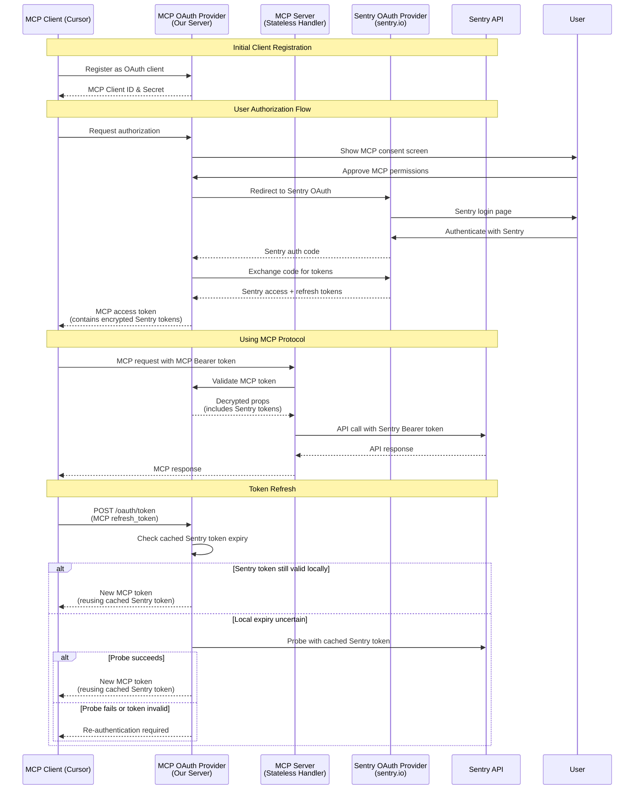
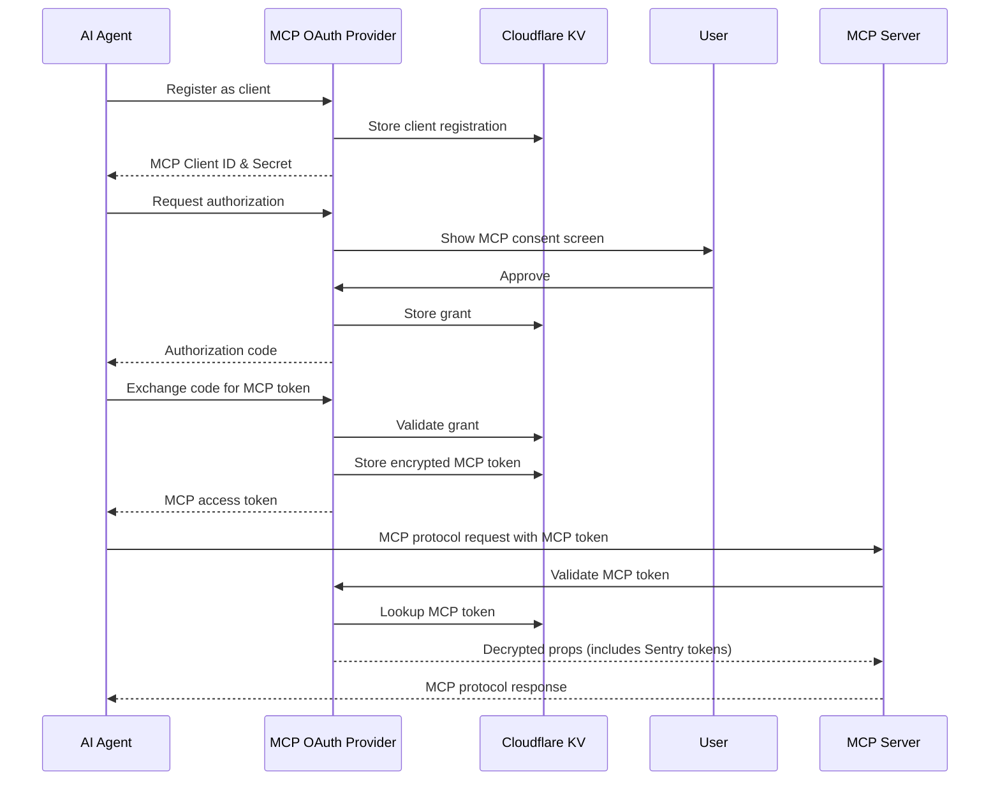

# OAuth Architecture: MCP OAuth vs Sentry OAuth

## Two Separate OAuth Systems

The Sentry MCP implementation involves **two completely separate OAuth providers**:

### 1. MCP OAuth Provider (Our Server)

- **What it is**: Our own OAuth 2.0 server built with `@cloudflare/workers-oauth-provider`
- **Purpose**: Authenticates MCP clients (like Cursor, VS Code, etc.)
- **Tokens issued**: MCP access tokens and MCP refresh tokens
- **Storage**: Uses Cloudflare KV to store encrypted tokens
- **Endpoints**: `/oauth/register`, `/oauth/authorize`, `/oauth/token`

### 2. Sentry OAuth Provider (Sentry's Server)

- **What it is**: Sentry's official OAuth 2.0 server at `sentry.io`
- **Purpose**: Authenticates users and grants API access to Sentry
- **Tokens issued**: Sentry access tokens and Sentry refresh tokens
- **Storage**: Tokens are stored encrypted within MCP's token props
- **Endpoints**: `https://sentry.io/oauth/authorize/`, `https://sentry.io/oauth/token/`

## High-Level Flow

The system uses a dual-token approach:

1. **MCP clients** authenticate with **MCP OAuth** to get MCP tokens
2. **MCP OAuth** authenticates with **Sentry OAuth** to get Sentry tokens
3. **MCP tokens** contain encrypted **Sentry tokens** in their payload
4. When serving MCP requests, the server uses Sentry tokens to call Sentry's API

### Complete Flow Diagram



## Key Concepts

### Token Types

| Token Type                    | Issued By                   | Used By            | Contains                | Purpose                                 |
| ----------------------------- | --------------------------- | ------------------ | ----------------------- | --------------------------------------- |
| **MCP Access Token**          | MCP OAuth Provider          | MCP Clients        | Encrypted Sentry tokens | Authenticate to MCP Server              |
| **MCP Refresh Token**         | MCP OAuth Provider          | MCP Clients        | Grant reference         | Refresh MCP access tokens               |
| **Sentry Access Token**       | Sentry OAuth                | MCP Server         | User credentials        | Call Sentry API                         |
| **Sentry Refresh Token**      | Sentry OAuth                | MCP OAuth Provider | Refresh credentials     | Refresh Sentry tokens                   |
| **Explicit Sentry API Token** | External client or provider | MCP Server         | Opaque Sentry API token | Direct remote auth with `Sentry-Bearer` |

### Not a Simple Proxy

**Important**: MCP is NOT an HTTP proxy that forwards requests. Instead:

- MCP implements the **Model Context Protocol** (tools, prompts, resources)
- Clients send MCP protocol messages, not HTTP requests
- MCP Server executes these commands using Sentry's API
- Responses are MCP protocol messages, not raw HTTP responses

## Technical Implementation

### MCP OAuth Provider Details

The MCP OAuth Provider is built with `@cloudflare/workers-oauth-provider` and provides:

1. **Dynamic client registration** - MCP clients can register on-demand
2. **PKCE support** - Secure authorization code flow
3. **Token management** - Issues and validates MCP tokens
4. **Consent UI** - Custom approval screen for permissions. Cancel redirects the MCP client to its registered `redirect_uri` with `error=access_denied` (RFC 6749 §4.1.2.1).
5. **Token encryption** - Stores Sentry tokens encrypted in MCP token props

### Sentry OAuth Integration

The integration with Sentry OAuth happens through:

1. **Authorization redirect** - After MCP consent, redirect to Sentry OAuth
2. **Code exchange** - Exchange Sentry auth code for tokens
3. **Token storage** - Store Sentry tokens in MCP token props
4. **Token reuse on refresh** - Re-issue MCP tokens while the cached Sentry access token is still usable

## Key Concepts

### How the MCP OAuth Provider Works



## Implementation Details

### 1. MCP OAuth Provider Configuration

The MCP OAuth Provider is configured in `src/server/index.ts`:

```typescript
const oAuthProvider = new OAuthProvider({
  apiHandlers: {
    "/sse": createMcpHandler("/sse", true),
    "/mcp": createMcpHandler("/mcp", false),
  },
  defaultHandler: app, // Hono app for non-OAuth routes
  authorizeEndpoint: "/oauth/authorize",
  tokenEndpoint: "/oauth/token",
  clientRegistrationEndpoint: "/oauth/register",
  clientIdMetadataDocumentEnabled: true,
  clientIdMetadataDocuments: CLIENT_ID_METADATA_DOCUMENTS,
  scopesSupported: Object.keys(SCOPES),
});
```

#### Operator-managed client metadata

URL-based clients normally use Client ID Metadata Documents (CIMD). The provider
fetches and validates the document during authorization, code exchange, and
refresh. A failed fetch can block these operations; requests using an existing
valid MCP access token do not need that lookup.

The exact Codex client ID, `https://chatgpt.com/oauth/codex/client.json`, is
registered in
[`client-metadata.ts`](../../packages/mcp-cloudflare/src/server/oauth/client-metadata.ts)
using its official metadata. This registration takes precedence over remote
fetches and their cache, so an upstream `403` cannot block this client's OAuth
flow. Other URL-based clients still use CIMD, and dynamic client registration
is unchanged. Query-string variants of the Codex client ID are distinct clients
and are not covered by this registration.

The provider's existing metadata and client ID validation still applies. The
registration allows only the official loopback callback URIs (with the existing
native-client port matching), requires S256 PKCE, and does not skip user consent
or Sentry authentication.

MCP maintainers own this registration. Changes to the official document,
including removal of a redirect URI or retirement of the client, must be reviewed
and reflected here; they are not adopted automatically. To resume remote lookup,
remove the entry after verifying fetches from a deployed Worker. Do not populate
registrations from incoming requests or use a failed fetch to restore previously
removed metadata.

The `clientIdMetadataDocuments` option is provided by the version-specific pnpm
patch in [`patches/`](../../patches/@cloudflare__workers-oauth-provider@0.10.3.patch), because provider 0.10.3 has no supported
registration override while CIMD is enabled. It resolves registrations in the
provider's common client lookup, covering authorization helpers and the token
endpoint. When upgrading the provider, port the patch or adopt an equivalent
upstream option, and run
`pnpm --filter @sentry/mcp-cloudflare exec vitest run src/server/oauth/client-metadata.integration.test.ts`.
The regression exercises the production provider with blocked metadata, token
exchange and refresh, and checks that OAuth validation remains enforced.

The patch also validates CIMD client ID syntax before authorization looks up
metadata, using the provider's existing validator. Invalid identifiers produce
`AuthorizationError` and a local `400` without redirecting. Fetch failures and
invalid metadata for syntactically valid URLs still propagate as `CimdFetchError`.
Dynamic client registration and the token endpoint retain their existing behavior.
Run `src/server/oauth/client-id-validation.integration.test.ts` with the command
above when changing this patch.

### 2. API Handler

The `apiHandler` is a protected endpoint that requires valid OAuth tokens:

- `/mcp` - MCP protocol endpoint (HTTP transport)

The handler receives:

- `request`: The incoming request
- `env`: Cloudflare environment bindings
- `ctx`: Execution context with `ctx.props` containing decrypted user data

### 3. Token Structure

MCP tokens contain encrypted properties including Sentry tokens:

```typescript
interface WorkerProps {
  id: string; // Sentry user ID
  accessToken: string; // Sentry access token
  refreshToken?: string; // Sentry refresh token
  accessTokenExpiresAt?: number; // Cached validity deadline; extended after probes
  sessionStartedAt?: number; // MCP grant creation timestamp
  upstreamExpiresAt?: number; // Original Sentry expiry timestamp
  clientId: string; // MCP client ID
  scope: string; // MCP permissions granted
  grantedSkills?: string[]; // Skills granted (primary authorization)
  // grantedScopes is deprecated and will be removed Jan 1, 2026
  upstreamScopes?: string[]; // Scopes Sentry granted on the upstream token
}
```

### 4. URL Constraints Challenge

#### The Problem

The MCP server needs to support URL-based constraints like `/mcp/sentry/javascript` to limit agent access to specific organizations/projects. However:

1. OAuth Provider only does prefix matching (`/mcp` matches `/mcp/*`)
2. The MCP handler needs to extract constraints from URL paths
3. URL path parameters must be preserved through the OAuth middleware

#### The Solution

The MCP handler parses URL path segments to extract organization and project constraints:

**Example URLs:**

- `/mcp` - No constraints (full access within granted scopes)
- `/mcp/sentry` - Organization constraint (limited to "sentry" org)
- `/mcp/sentry/javascript` - Organization + project constraints

The handler extracts these constraints, combines them with authentication data from the OAuth provider (via ExecutionContext), and builds the complete ServerContext. This context determines which resources tools can access.

## Storage (KV Namespace)

The MCP OAuth Provider uses `OAUTH_KV` namespace to store:

1. **MCP Client registrations**: `client:{clientId}` - MCP OAuth client details
2. **MCP Authorization grants**: `grant:{userId}:{grantId}` - User consent records for MCP
3. **MCP Access tokens**: `token:{userId}:{grantId}:{tokenId}` - Encrypted MCP tokens (contains Sentry tokens)
4. **MCP Refresh tokens**: `refresh:{userId}:{grantId}:{refreshId}` - For MCP token renewal

### Token Storage Structure

When a user completes the full OAuth flow, the MCP OAuth Provider stores Sentry tokens inside MCP token props:

```typescript
// In /oauth/callback after exchanging code with Sentry
const { redirectTo } = await c.env.OAUTH_PROVIDER.completeAuthorization({
  // ... other params
  props: {
    id: payload.user.id, // From Sentry
    accessToken: payload.access_token, // Sentry's access token
    refreshToken: payload.refresh_token, // Sentry's refresh token
    accessTokenExpiresAt: Date.now() + payload.expires_in * 1000,
    sessionStartedAt: Date.now(),
    upstreamExpiresAt: Date.now() + payload.expires_in * 1000,
    clientId: oauthReqInfo.clientId, // MCP client ID
    scope: oauthReqInfo.scope.join(" "), // MCP scopes
    grantedSkills: Array.from(validSkills), // Skills granted (primary authorization)
    // ... other fields
  },
});
```

## Token Refresh Implementation

### MCP Refresh Model

The system only refreshes MCP tokens. It does not rotate upstream Sentry OAuth
tokens anymore.

1. **MCP Token Refresh**: MCP clients exchange an MCP refresh token for a new MCP access token
2. **Sentry Token Reuse**: The worker keeps reusing the cached Sentry access token while it is still valid
3. **Stale grant rejection**: Grants missing required stored props like `refreshToken` are treated as stale and revoked
4. **Re-auth on expiry**: Once the cached Sentry access token is no longer usable, the client must complete OAuth again

### MCP Token Refresh Flow

When an MCP client's token expires:

1. Client sends refresh request to MCP OAuth: `POST /oauth/token` with MCP refresh token
2. MCP OAuth invokes `tokenExchangeCallback` function
3. Callback checks if cached Sentry token is still valid (with a 2-minute safety window)
4. If the local expiry is still safely in the future, it returns a new MCP token immediately
5. If the local expiry is stale or near expiry, it probes Sentry with the cached access token
6. If the probe succeeds, it returns a new MCP token using the same cached Sentry token
7. If the probe shows the token is invalid, or the worker cannot verify validity, the client must re-authenticate

### Token Exchange Callback Implementation

```typescript
// tokenExchangeCallback in src/server/oauth/helpers.ts
export async function tokenExchangeCallback(
  options,
  env,
  request,
  clientFamily,
) {
  // Only handle MCP refresh_token requests
  if (options.grantType !== "refresh_token") {
    return undefined;
  }

  if (!options.props.refreshToken) {
    return undefined;
  }

  // Smart caching: Check if Sentry token is still valid
  const sentryTokenExpiresAt = props.accessTokenExpiresAt;
  if (sentryTokenExpiresAt && Number.isFinite(sentryTokenExpiresAt)) {
    const remainingMs = sentryTokenExpiresAt - Date.now();
    const SAFE_WINDOW_MS = 2 * 60 * 1000; // 2 minutes safety

    if (remainingMs > SAFE_WINDOW_MS) {
      // Sentry token still valid - return new MCP token with cached Sentry token
      return {
        newProps: { ...options.props },
        accessTokenTTL: Math.floor(remainingMs / 1000),
      };
    }
  }

  // Local expiry is not enough to trust the token, so probe upstream.
  const api = new SentryApiService({
    accessToken: props.accessToken,
    host: env.SENTRY_HOST || "sentry.io",
  });
  await api.getAuthenticatedUser();

  return {
    newProps: { ...options.props },
    accessTokenTTL: 60 * 60,
  };
}
```

### Error Scenarios

1. **Legacy grant missing Sentry refresh token**:
   - Behavior: The refresh exchange immediately stops returning new MCP tokens
   - Resolution: The next `/mcp` request revokes the stale grant and requires a clean re-authentication flow

2. **Cached Sentry token invalid**:
   - Error: Sentry probe returns 400/401
   - Resolution: Client must re-authenticate with MCP and Sentry

3. **Verification indeterminate**:
   - Error: Network failure, timeout, or upstream 5xx while probing validity
   - Resolution: The current implementation fails closed and requires re-authentication

The 2-minute safety window prevents edge cases with clock skew and processing delays between MCP and Sentry.

## Security Features

1. **PKCE**: MCP OAuth uses PKCE to prevent authorization code interception
2. **Token encryption**: Sentry tokens encrypted within MCP tokens using WebCrypto
3. **Dual consent**: Users approve both MCP permissions and Sentry access
4. **Scope enforcement**: Both MCP and Sentry scopes limit access
5. **Token expiration**: Both MCP and Sentry tokens have expiry times
6. **Fail-closed verification**: If the worker cannot verify token validity confidently, it requires re-authentication rather than extending access speculatively

## Discovery Endpoints

The MCP worker exposes:

- `/.well-known/oauth-authorization-server` - MCP OAuth server metadata
- `/.well-known/oauth-protected-resource/mcp...` - Path-specific protected resource metadata per RFC 9728
- `/.well-known/oauth-authorization-server/mcp...` - Compatibility metadata for clients that probe path-scoped RFC 8414 discovery from the MCP resource URL

The worker only serves path-specific protected-resource metadata for `/mcp...`
resources. Each metadata document preserves the exact `/mcp` path and any query
parameters so the advertised `resource` value matches the protected resource
identifier used for discovery.

The path-scoped RFC 8414 discovery endpoint is a compatibility shim. It is not
the canonical MCP discovery flow. Instead, it exists for clients that infer the
RFC 8414 URL directly from the `/mcp/...` endpoint path. The compatibility
response keeps the exact protected-resource query string in the RFC 8707
`resource` parameter, while emitting a query-free `issuer` so the document
remains valid RFC 8414 metadata.

When a constrained OAuth request includes `resource=/mcp/{org}` or
`resource=/mcp/{org}/{project}`, the approval page surfaces that scope to the
user as a "Session scope" banner before permissions are granted.

Note: These describe the MCP OAuth server, not Sentry's OAuth endpoints.

## Direct Sentry-Bearer Mode

Cloudflare `/mcp` also supports an explicit upstream Sentry API token:

```http
Authorization: Sentry-Bearer <sentry_api_token>
```

This is not part of the dual OAuth flow. The worker handles the request before
the MCP OAuth provider, builds `ServerContext` with the provided token, and uses
the same Sentry API client calls as OAuth-backed sessions.

Direct mode intentionally does not:

- validate the token before initializing the MCP server
- store the token in KV
- mint or refresh MCP OAuth tokens
- refresh upstream Sentry tokens
- revoke MCP grants when Sentry rejects the upstream token

The caller owns token lifetime and refresh. `Authorization: Bearer ...` remains
reserved for MCP OAuth access tokens.

## Integration Between MCP OAuth and MCP Server

The MCP Server (stateless handler) receives context via closure capture:

1. **Props via ExecutionContext**: Decrypted data from MCP token (includes Sentry tokens)
2. **Constraints from URL**: Organization/project limits parsed from URL path
3. **Context capture**: Server built with context, captured in tool handler closures

The MCP Server then uses the Sentry access token from context to make Sentry API calls.

## Limitations

1. **No direct Hono integration**: OAuth Provider expects specific handler signatures
2. **Constraint extraction**: Must parse URL segments to extract organization/project constraints

## Why Use Two OAuth Systems?

### Benefits of the Dual OAuth Approach

1. **Security isolation**: MCP clients never see Sentry tokens directly
2. **Token management**: MCP can re-issue its own tokens while reusing cached Sentry credentials
3. **Permission layering**: MCP permissions separate from Sentry API scopes
4. **Client flexibility**: MCP clients don't need to understand Sentry OAuth

### Why Not Direct Sentry OAuth?

If MCP clients used Sentry OAuth directly:

- Clients would need to manage Sentry token lifetime and re-authentication directly
- No way to add MCP-specific permissions
- Clients would have raw Sentry API access (security risk)
- No centralized token management

### Implementation Complexity

The MCP OAuth Provider (via `@cloudflare/workers-oauth-provider`) provides:

- OAuth 2.0 authorization flows
- Dynamic client registration
- Token issuance and validation
- PKCE support
- Consent UI
- Token encryption
- KV storage
- Discovery endpoints

Reimplementing this would be complex and error-prone.

## Related Documentation

- [Cloudflare OAuth Provider](https://github.com/cloudflare/workers-oauth-provider)
- [OAuth 2.0 Specification](https://oauth.net/2/)
- [Dynamic Client Registration](https://www.rfc-editor.org/rfc/rfc7591.html)
- [PKCE](https://www.rfc-editor.org/rfc/rfc7636)
