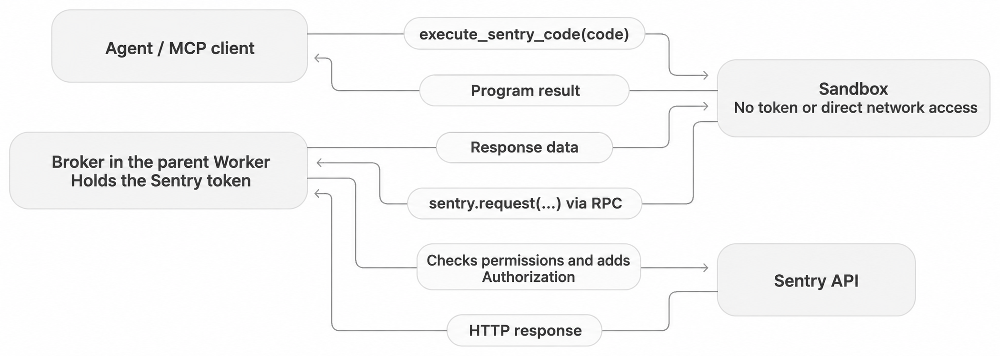

# HTTP Code Mode

HTTP Code Mode lets an external MCP agent discover published API operations,
write JavaScript, and execute authenticated HTTP requests without a dedicated
tool for each operation. This version is HTTP-only; an SDK interface is deferred.

## Execution and ownership

The hosted MCP exposes two ordinary MCP tools:

- `search_sentry_api({code})` runs an async arrow function against the configured
  OpenAPI document, available as `spec`. Network access is disabled.
- `execute_sentry_code({code})` runs an async arrow function with
  `sentry.request({method?, path, query?, body?})`, defaulting to GET. Requests
  return `{status, headers, body}`; non-2xx responses throw with HTTP details.

The client's model discovers the API, generates code, corrects failures and
writes the answer. The server executes that code in a fresh Cloudflare Dynamic
Worker and does not call a model. Programs can paginate, combine responses and
return selected fields without sending every intermediate response to the model.
Query arrays become repeated parameters; `headers.link` supports pagination.

| Responsibility                                 | Owner and cost                                  |
| ---------------------------------------------- | ----------------------------------------------- |
| Planning, code generation and final answer     | Client's agent/provider account                 |
| Schema search, execution and credential broker | MCP operator's Cloudflare infrastructure        |
| API requests                                   | Sentry infrastructure and applicable API limits |

This follows Cloudflare's [server-side search/execute pattern](https://blog.cloudflare.com/code-mode-mcp/).
Worker Loader creates a fresh isolate with `globalOutbound: null`. Raw `fetch()`
and other network access are blocked. A trusted wrapper calls an `ApiBroker`
RPC capability passed to `run()`; the broker owns credentials in the parent
request context. Generated code is a separate module and cannot access them.
The broker validates the origin and API prefix, supplies authentication and
rejects redirects. The request-scoped capability also retains the existing
unauthorized callback, which cannot be serialized into loopback binding props.



Code Mode is an architecture, not a separate MCP protocol capability. Tools use
normal `tools/list` and `tools/call`, typed schemas, JSON text and
`structuredContent`; failures use `isError`. The MCP SDK's package version is
separate from the dated [wire protocol](https://modelcontextprotocol.io/specification/2026-07-28/server/tools).

## Authentication and scope

`packages/mcp-cloudflare/src/server/lib/mcp-handler.ts` creates a fresh server
for each authenticated request and registers Code Mode with that request's
`ServerContext`. The existing OAuth flow and requested upstream scopes remain
unchanged. Production and canary configurations provide a `LOADER` binding.
Code Mode is hosted-only, with no separate OAuth flow or rollout flag.

Two permissions control access through this MCP connection:

- **API Read** permits reads and is selected for new approvals.
- **API Write** permits reads and create/update/delete operations. It starts
  unchecked. Explicitly remembered selections can preselect it, but approval
  is still required.

Existing grants and remembered skill selections do not acquire new permissions
implicitly. Permissions are additive: API Write can modify issues with **Triage
Issues** unchecked, or projects/teams with **Manage Projects & Teams** unchecked.
Those checkboxes control their catalog tools, not deny rules for API Write. The
consent screen explains this before selection and always displays the scope:
`/mcp` permits organizations authorized by the token; `/mcp/{org}` limits the
connection to that organization. Sentry's own permissions still apply.

The token authenticates API calls and sets the maximum access through its OAuth
scopes and the user's permissions. The consent screen limits what this MCP
connection may do without changing the token or its scopes. The implementation
keeps three values distinct:

- `grantedSkills` records MCP authorization; `api-write` includes reads.
- Legacy `grantedScopes` comes from tool declarations. It is not evidence of
  token permissions, and Code Mode does not use it.
- `upstreamScopes` records Sentry's actual token response. Missing metadata on
  older grants means unknown. It neither grants MCP access nor replaces backend
  token, role and resource checks.

Before every `sentry.request()`, the broker's `ApiAuthorization` checks:

1. The exact path and method exist in the pinned OpenAPI. HEAD may use a GET
   contract when no HEAD operation exists. Unknown or ambiguous paths fail.
2. Without `api-write`, only GET, HEAD and OPTIONS can reach Sentry, regardless
   of the token's broader access.
3. An organization constraint matches a recognized organization path parameter
   exactly. Other organizations, unresolved numeric aliases and global object-ID
   routes fail. Query parameters cannot substitute for a scoped path.

The policy uses the existing organization helper for regional routing, validates
the regional host before attaching credentials, and forwards MCP client
attribution. A 401 invokes the existing unauthorized callback once per policy
instance. Sentry performs its own token, role and resource authorization.

For example, dashboard creation accepts `org:read`, `org:write` or `org:admin`
upstream. API Write lets that POST reach Sentry without inventing a `:write`
suffix requirement. API Read blocks it before contacting Sentry. Neither MCP
permission guarantees that Sentry will accept the request.

Project-constrained connections retain their existing tools without Code Mode.
A project URL alone cannot prove isolation: release files can be shared across
projects, and release deploys can affect every project when `projects` is omitted.
The published schema has no general isolation contract for these resources.
The policy therefore does not infer isolation from path prefixes or add filters
to arbitrary operations. The backend references are
`src/sentry/releases/endpoints/project_release_file_details.py` and
`src/sentry/releases/endpoints/release_deploys.py`.

## Discovery and HTTP contracts

The schema ships with the deploy, as Cloudflare's Code Mode server does: nothing
fetches or syncs it at runtime. `src/code-mode/generated/openapi.json.txt` is
Sentry's published `openapi-derefed.json` at the commit in
`src/code-mode/generated/source.json` (currently
`803d6de98c9156c15e9ddc1bf9accbac6e24cebc`), minified and ASCII-escaped. It is a
Workers Text module: the main Worker parses it once per isolate, on first use,
for authorization, and each search sandbox receives the same text as its own
module and parses it there. This is the same artifact family the CLI consumes.
The pinned snapshot contains 159 paths / 254 operations, not every Sentry
feature or internal endpoint.

Bump the pin in a pull request so the regenerated schema is reviewed:

```bash
pnpm --filter @sentry/mcp-cloudflare generate:openapi --commit <sha>
```

Without `--commit`, the script rewrites the current pin. Never edit the
generated files by hand.

Tool descriptions guide searches across paths, operation IDs, summaries,
descriptions and tags. Empty or unrelated results should lead to broader metadata
or category searches before guessing routes. Discovery does not add a second
operation catalog, synonym list or semantic search service.

After finding an operation, inspect its request/response schemas and both
path-level and operation-level parameters. The latter override path parameters
with the same name and location. Return selected JSON values rather than sliced
JSON strings that may hide required fields.

Write guidance distinguishes raw API bodies from enriched catalog-tool results.
Even a GET response is not a write template: resending an aggregate field can
change child resources. Agents should consult the contract and defaults, read
the current resource, send required fields and requested changes, and preserve
IDs and relationships in nested collections. Omission is not assumed to preserve
every field, and PUT is not assumed to replace every resource. Agents should
verify the result and report ambiguity or side effects rather than inventing
semantics or attempting speculative repair writes.

These instructions cannot enforce endpoint-specific preservation. JSON/HTTP
support does not establish multipart, streaming, internal or undocumented API
coverage. Result projection is available but not automatic semantic truncation.

## Limits and failures

Each execution has a 20-call fetch budget, 30-second deadline, 50,000-byte
result limit and 2,000,000-byte upstream response limit. The HTTP MCP SDK rejects
tool arguments with more than 10,000 array elements or object keys before
validation. A bounded reader rejects request bodies over 1 MiB before dispatch,
including legacy clients whose Agents transport omits the SDK body-limit option.

Dynamic Worker CPU and subrequest limits are configured through the
[Cloudflare API](https://developers.cloudflare.com/dynamic-workers/usage/limits/).
Local workerd did not enforce those platform limits in the recorded probes.
**Hosted CPU termination and deployment enforcement remain unvalidated.**

The runtime has no automatic retries or multi-call transaction. A failed program
may already have created resources; the agent must inspect state before retrying
writes. HTTP errors preserve status, message and allowed headers such as
`WWW-Authenticate` and `Retry-After`. A generic 403 is not diagnosed as a missing
scope or a need to reconnect. Uncaught program errors retain execution statistics
when available; startup failures do not have sandbox statistics.

Upstream 5xx responses use the existing `logIssue` helper even when generated
code catches them. The broker exposes the event ID as `x-sentry-event-id` and
reports only method, status and the operation's path template, not request or
response payloads. Expected 4xx responses do not create issues.

Failures outside the program, such as the Worker Loader failing or the sandbox
dying, also use `logIssue`; the tool error ends with the event ID. Program
errors and the execution deadline do not create issues.

## Telemetry

Each `tools/call` span records what the execution did, so one bad run can be
read back from its trace:

- `gen_ai.tool.call.arguments.code` - the generated program, like every other
  tool's arguments
- `app.code_mode.outcome` - `ok`, `error` (the program failed or returned an
  error), `timeout` or `internal_error`
- `app.code_mode.spec_commit` - the schema commit the deploy shipped
- `app.code_mode.api_calls`, `app.code_mode.writes` - calls seen by the broker
  and writes it sent to Sentry (execute only)
- `app.code_mode.operations` - JSON list of `METHOD template status`, with
  `denied` when this connection's policy refused the call (execute only)

Spans are sampled. Two metrics are not, so they count every execution:

- `app.code_mode.execution` with `tool` and `outcome`
- `app.code_mode.request` with `method`, `operation` (the path template, or
  `unknown` when the path is not in the schema), `status` and `denied`

The broker records operations outside the sandbox; generated code cannot change
them. Concrete URLs, query strings and bodies are never recorded.

`LOADER.load()` creates a fresh Worker for each execution without ID caching,
following the [Worker Loader API](https://developers.cloudflare.com/dynamic-workers/api-reference/#load).
This preserves per-execution isolation but affects
[Dynamic Workers costs](https://developers.cloudflare.com/dynamic-workers/pricing/).
Any later reuse must preserve request credentials and authorization; changing
the ID alone is insufficient.

### Lifecycle investigation

The parent owns one `ExecutionGate` per tool call, closed in `finally` on success,
error or timeout. Its 30-second deadline covers Worker startup, execution and
reading the result. The sandbox receives the same deadline.

Like Cloudflare's [ExecutionGate](https://github.com/cloudflare/agents/blob/a2d371ec333198855f4ac2aa4dadbe2696e73c75/packages/codemode/src/executor.ts),
closing releases pending sandbox-to-host RPC. The Sentry gate also aborts
upstream HTTP and rejects new work before authorization, then checks again after
authorization before sending an API request. A slow authorization lookup cannot
start a write after execution has closed.

Programs must await every `sentry.request()`, including parallel calls. Returning
with calls still pending is an execution error, not success. Throwing preserves
the original error while cleanup aborts pending requests. The sandbox disables
its API access when the program ends; the parent broker enforces the boundary
independently of generated code. Closed RPC calls settle with an error response
instead of an unhandled rejection.

Before returning success, the sandbox gives workerd a turn to report unhandled
promise rejections. A failed request cannot disappear just because it settled
before the program returned. Handled errors, including late catches and
`Promise.allSettled`, remain valid. API access closes before that final turn.

Cancellation is best effort for HTTP already sent: a write accepted upstream
cannot be rolled back. The tool retains the warning to inspect state before
retrying writes. Gate closure revokes API access; it does not forcibly terminate
JavaScript still running inside an isolate. CPU and platform concurrency
enforcement still require hosted verification. Local handles do not expose
`Symbol.dispose`, so cleanup does not depend on optional disposal.

## Runtime and integration validation

Use Node 24 for this checkout; its `better-sqlite3` dependency does not compile
with Node 26. After `pnpm install --frozen-lockfile`:

```bash
pnpm --filter '@sentry/mcp-core...' --if-present run build
pnpm --filter @sentry/mcp-cloudflare test
pnpm --filter @sentry/mcp-cloudflare tsc:ci
```

There is one composition: `registerCodeModeTools()` on the authenticated MCP
handler, with its `ApiAuthorization` always applied. The tests drive that
handler with real Dynamic Workers and the RPC broker, the shipped schema, and
simulated Sentry HTTP. They cover grant and scope visibility, regional routing,
attribution, concurrent token isolation, organization escapes, 401 revocation,
caught 5xx reporting, modern/legacy input limits, the published search examples,
network denial, path escapes, redirects, pending and ignored requests, limits
and telemetry. Dashboard copying verifies persisted state with API Write and an
upstream `org:read` token.

Three regressions reproduce the original closure bugs: return/throw with pending
HTTP and delayed authorization. The contexts stay alive after the result to
prove cleanup does not depend on request teardown. Two fake-timer tests check
that the deadline aborts a request stalled before its headers or during its
body.

For a manual run against a real account, start the hosted server with
`pnpm run dev` and connect with `Authorization: Sentry-Bearer <token>` and
`?skills=api-read` or `?skills=api-write`; this is the same code path.

These checks use external HTTP fixtures, not a real Sentry account or deployment.
No new model evals were run; the agent harness remains in its separate PR.
Unrelated CLI fixture/platform failures prevented a green full workspace suite.
Before production, validate hosted OAuth-to-API authorization and Cloudflare
CPU/termination limits. No deployment
is established by these checks.

## References

- Implementation: `packages/mcp-cloudflare/src/code-mode/tools.ts`
  (registration and execution), `authorization.ts`, `access.ts`, `broker.ts`,
  `sandbox.ts` and `openapi.ts`; tool definitions in
  `packages/mcp-core/src/code-mode.ts`.
- Integration tests:
  `packages/mcp-cloudflare/src/server/lib/code-mode.integration.test.ts`.
- [Cloudflare architecture](../cloudflare/architecture.md) and
  [OAuth architecture](../cloudflare/oauth-architecture.md).
- [Stainless SDK Code Mode](https://www.stainless.com/blog/sdk-code-mode/)
  describes the deferred SDK interface; it does not change who owns model usage.
