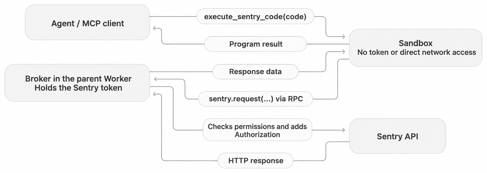

# HTTP Code Mode

HTTP Code Mode lets an external MCP agent discover published API operations,
write JavaScript, and execute authenticated HTTP requests without a dedicated
tool for each operation. This version is HTTP-only; an SDK interface is deferred.

## Execution and ownership

The hosted MCP exposes two ordinary MCP tools:

- `search_sentry_api({code})` runs an async arrow function against the configured
  OpenAPI document, available as `spec`. Network access is disabled.
- `execute_sentry_code({code})` runs an async arrow function with
  `sentry.request({method?, path, query?, body?})`, defaulting to GET. Requests
  return `{status, headers, body}`; non-2xx responses throw with HTTP details.

The client's model discovers the API, generates code, corrects failures and
writes the answer. The server executes that code in a fresh Cloudflare Dynamic
Worker and does not call a model. Programs can paginate, combine responses and
return selected fields without sending every intermediate response to the model.
Query arrays become repeated parameters; `headers.link` supports pagination.

| Responsibility                                 | Owner and cost                                  |
| ---------------------------------------------- | ----------------------------------------------- |
| Planning, code generation and final answer     | Client's agent/provider account                 |
| Schema search, execution and credential broker | MCP operator's Cloudflare infrastructure        |
| API requests                                   | Sentry infrastructure and applicable API limits |

This follows Cloudflare's [server-side search/execute pattern](https://blog.cloudflare.com/code-mode-mcp/).
Worker Loader creates a fresh isolate with `globalOutbound: null`. Raw `fetch()`
and other network access are blocked. A trusted wrapper calls an `ApiBroker`
RPC capability passed to `run()`; the broker owns credentials in the parent
request context. Generated code is a separate module and cannot access them.
The broker validates the origin and API prefix, supplies authentication and
rejects redirects. The request-scoped capability also retains the existing
unauthorized callback, which cannot be serialized into loopback binding props.



Code Mode is an architecture, not a separate MCP protocol capability. Tools use
normal `tools/list` and `tools/call`, typed schemas, JSON text and
`structuredContent`; failures use `isError`. The MCP SDK's package version is
separate from the dated [wire protocol](https://modelcontextprotocol.io/specification/2026-07-28/server/tools).

## Authentication and scope

`packages/mcp-cloudflare/src/server/lib/mcp-handler.ts` creates a fresh server
for each authenticated request and registers Code Mode with that request's
`ServerContext`. The existing OAuth flow and requested upstream scopes remain
unchanged. Production and canary configurations provide a `LOADER` binding.
Code Mode is hosted-only, with no separate OAuth flow or rollout flag.

Two permissions control access through this MCP connection:

- **API Read** permits reads and is selected for new approvals.
- **API Write** permits reads and create/update/delete operations. It starts
  unchecked. Explicitly remembered selections can preselect it, but approval
  is still required.

Existing grants and remembered skill selections do not acquire new permissions
implicitly. Permissions are additive: API Write can modify issues with **Triage
Issues** unchecked, or projects/teams with **Manage Projects & Teams** unchecked.
Those checkboxes control their catalog tools, not deny rules for API Write. The
consent screen explains this before selection and always displays the scope:
`/mcp` permits organizations authorized by the token; `/mcp/{org}` limits the
connection to that organization. Sentry's own permissions still apply.

The token authenticates API calls and sets the maximum access through its OAuth
scopes and the user's permissions. The consent screen limits what this MCP
connection may do without changing the token or its scopes. The implementation
keeps three values distinct:

- `grantedSkills` records MCP authorization; `api-write` includes reads.
- Legacy `grantedScopes` comes from tool declarations. It is not evidence of
  token permissions, and Code Mode does not use it.
- `upstreamScopes` records Sentry's actual token response. Missing metadata on
  older grants means unknown. It neither grants MCP access nor replaces backend
  token, role and resource checks.

Before every `sentry.request()`, the broker's `ApiAuthorization` checks:

1. The exact path and method exist in the pinned OpenAPI. HEAD may use a GET
   contract when no HEAD operation exists. Unknown or ambiguous paths fail.
2. Without `api-write`, only GET, HEAD and OPTIONS can reach Sentry, regardless
   of the token's broader access.
3. An organization constraint matches a recognized organization path parameter
   exactly. Other organizations, unresolved numeric aliases and global object-ID
   routes fail. Query parameters cannot substitute for a scoped path.

The policy uses the existing organization helper for regional routing, validates
the regional host before attaching credentials, and forwards MCP client
attribution. A 401 invokes the existing unauthorized callback once per policy
instance. Sentry performs its own token, role and resource authorization.

For example, dashboard creation accepts `org:read`, `org:write` or `org:admin`
upstream. API Write lets that POST reach Sentry without inventing a `:write`
suffix requirement. API Read blocks it before contacting Sentry. Neither MCP
permission guarantees that Sentry will accept the request.

Project-constrained connections retain their existing tools without Code Mode.
A project URL alone cannot prove isolation: release files can be shared across
projects, and release deploys can affect every project when `projects` is omitted.
The published schema has no general isolation contract for these resources.
The policy therefore does not infer isolation from path prefixes or add filters
to arbitrary operations. The backend references are
`src/sentry/releases/endpoints/project_release_file_details.py` and
`src/sentry/releases/endpoints/release_deploys.py`.

## Discovery and HTTP contracts

The default `OPENAPI_URL` uses Sentry's published `openapi-derefed.json`, pinned at
`803d6de98c9156c15e9ddc1bf9accbac6e24cebc`. This is the same artifact family the
CLI consumes. Custom schema URLs must supply trusted, pre-dereferenced JSON;
the runtime does not resolve or fetch references. The pinned snapshot contains
159 paths / 254 operations, not every Sentry feature or internal endpoint.

Tool descriptions guide searches across paths, operation IDs, summaries,
descriptions and tags. Empty or unrelated results should lead to broader metadata
or category searches before guessing routes. Discovery does not add a second
operation catalog, synonym list or semantic search service.

After finding an operation, inspect its request/response schemas and both
path-level and operation-level parameters. The latter override path parameters
with the same name and location. Return selected JSON values rather than sliced
JSON strings that may hide required fields.

Write guidance distinguishes raw API bodies from enriched catalog-tool results.
Even a GET response is not a write template: resending an aggregate field can
change child resources. Agents should consult the contract and defaults, read
the current resource, send required fields and requested changes, and preserve
IDs and relationships in nested collections. Omission is not assumed to preserve
every field, and PUT is not assumed to replace every resource. Agents should
verify the result and report ambiguity or side effects rather than inventing
semantics or attempting speculative repair writes.

These instructions cannot enforce endpoint-specific preservation. JSON/HTTP
support does not establish multipart, streaming, internal or undocumented API
coverage. Result projection is available but not automatic semantic truncation.

## Limits and failures

Each execution has a 20-call fetch budget, 30-second I/O deadline, 50,000-byte
result limit and 2,000,000-byte upstream response limit. The HTTP MCP SDK rejects
tool arguments with more than 10,000 array elements or object keys before
validation. A bounded reader rejects request bodies over 1 MiB before dispatch,
including legacy clients whose Agents transport omits the SDK body-limit option.

Dynamic Worker CPU and subrequest limits are configured through the
[Cloudflare API](https://developers.cloudflare.com/dynamic-workers/usage/limits/).
Local workerd did not enforce those platform limits in the recorded probes.
**Hosted CPU termination and deployment enforcement remain unvalidated.**

The runtime has no automatic retries or multi-call transaction. A failed program
may already have created resources; the agent must inspect state before retrying
writes. HTTP errors preserve status, message and allowed headers such as
`WWW-Authenticate` and `Retry-After`. A generic 403 is not diagnosed as a missing
scope or a need to reconnect. Uncaught program errors retain execution statistics
when available; startup failures do not have sandbox statistics.

Upstream 5xx responses use the existing `logIssue` helper even when generated
code catches them. The broker exposes the event ID as `x-sentry-event-id` and
reports only method/status, not request or response payloads. Expected 4xx
responses do not create issues.

Fresh Worker IDs preserve per-execution isolation but affect
[Dynamic Workers costs](https://developers.cloudflare.com/dynamic-workers/pricing/).
Any later reuse must preserve request credentials and authorization; changing
the ID alone is insufficient.

### Lifecycle investigation

Local probes on 2026-10-27 used the unchanged sandbox from `f4f0766b`, a small
parent reproducing the execution/deadline logic, and a local HTTP fixture on
Miniflare `5.20261019.1-beta` / workerd `1.20261019.1`. They used no real token
or Sentry API. `waitUntil` deliberately kept the parent context alive; these
results do not establish the lifetime of a hosted MCP request.

- With the real 30-second deadline, the parent returned timeout at 30.004s,
  but the sandbox settled at 30.503s. `Promise.race` stops waiting, not execution.
- An unawaited POST reached the fixture after the parent returned success,
  while still inside the deadline. Without the extended context, that probe
  ended before HTTP arrived. Execution closure currently depends on context
  cleanup, not an explicit broker close.
- The broker deadline rejected a request starting after expiry. Aborting an
  already-sent HTTP request did not undo the fixture's accepted write.

Cloudflare's [ExecutionGate](https://github.com/cloudflare/agents/blob/858674439f2966b16ea55bd37b46fad4248f2781/packages/codemode/src/executor.ts)
releases pending RPC when execution settles; it explicitly does not cancel host
work. A local reproduction confirmed that distinction. `LOADER.load()` worked,
but neither its handles nor `get()` handles exposed `Symbol.dispose` in this
installed runtime, so optional disposal alone would not fix these observations.

Before production, define and test execution closure: reject new broker work
after completion, check state/deadline before and after async authorization,
release pending RPC and abort in-flight HTTP where possible. Define how
unawaited requests affect the result. Verify hosted cleanup, cancellation and
CPU/concurrency enforcement separately. No cleanup can roll back accepted writes.
These findings are pending work, not a production-readiness sign-off.

## Runtime and integration validation

Use Node 24 for this checkout; its `better-sqlite3` dependency does not compile
with Node 26. After `pnpm install --frozen-lockfile`:

```bash
pnpm --filter '@sentry/mcp-core...' --if-present run build
pnpm --filter @sentry/mcp-cloudflare test
pnpm --filter @sentry/mcp-cloudflare test:code-mode
pnpm --filter @sentry/mcp-cloudflare tsc:code-mode
```

Cloudflare's `test:ci` and `tsc:ci` include the Code Mode checks. The ordinary
suite exercises the authenticated MCP handler, Dynamic Workers and RPC broker
with external OpenAPI/Sentry fixtures. It covers grant and scope visibility,
regional routing, attribution, concurrent token isolation, organization escapes,
401 revocation, caught 5xx reporting, and modern/legacy input limits. Dashboard
copying verifies persisted state with API Write and an upstream `org:read` token.

The isolated runtime suite uses `wrangler.code-mode.jsonc` to test execution,
network denial and API path restrictions. Its direct-token entrypoint is for
local tests, not hosted deployment or OAuth validation. Only the hosted handler
applies the connection's skills, constraints and regional policy.

`@cloudflare/vitest-plugin` 1.4.6 aligns the hosted test runtime with Wrangler and
the standalone Miniflare tests. Updating only direct Miniflare previously left
the Vitest pool using older workerd. Miniflare 5 uses
`convertV4MiniflareOptions()` for standalone configuration; hosted outbound
fixtures use the existing Undici `MockAgent` with `disableNetConnect()`. No
binary override is required.

Validation after separating agent evals on 2026-10-27 passed 469 hosted tests,
26 isolated runtime/access tests, root typechecks, frozen install and a
production Wrangler dry-run with `LOADER`. This is fixture-backed evidence,
not a real Sentry account or deployment.
Unrelated CLI fixture/platform failures prevented a green full workspace suite.
Before production, address the lifecycle findings above and validate hosted
OAuth-to-API authorization and Cloudflare CPU/termination limits. No deployment
is established by these checks.

## References

- Implementation: `packages/mcp-cloudflare/src/code-mode/production.ts`,
  `broker.ts`, `worker.ts`, `sandbox.ts` and `definitions.ts`.
- Integration tests:
  `packages/mcp-cloudflare/src/server/lib/code-mode.integration.test.ts`.
- [Cloudflare architecture](../cloudflare/architecture.md) and
  [OAuth architecture](../cloudflare/oauth-architecture.md).
- [Stainless SDK Code Mode](https://www.stainless.com/blog/sdk-code-mode/)
  describes the deferred SDK interface; it does not change who owns model usage.
